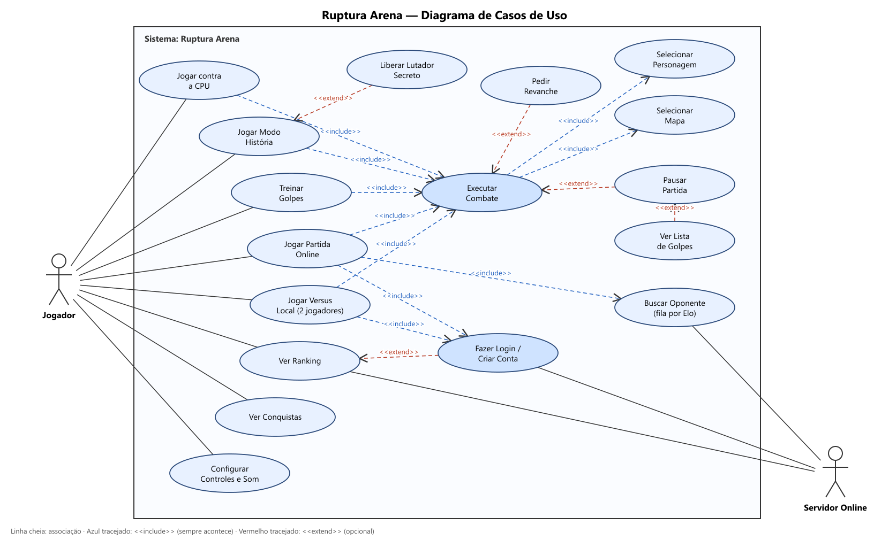

# Histórias de usuário — Ruptura Arena

Cada história nasce de um caso de uso do [diagrama de casos de uso](casos-de-uso.png). O formato é "Como **[quem]**, quero **[o quê]**, para **[por quê]**", seguido dos critérios de aceite: o que precisa funcionar para a história ser considerada pronta.

## Atores

| Ator | Quem é |
| --- | --- |
| **Jogador** | Quem usa o jogo. Pode jogar sem conta (contra a CPU, treino, Modo História) ou com conta (online, ranking, Versus Player como 1P, conquistas salvas). |
| **Servidor Online** | Ator secundário: o Supabase, que guarda as contas, o Elo, as conquistas, monta a fila e liga os dois jogadores de uma partida online. |

## Relações `<<include>>` e `<<extend>>`

| Relação | Por quê |
| --- | --- |
| Jogar contra a CPU, Versus Local, Online, Modo História e Treinar `<<include>>` **Executar Combate** | Todos esses modos sempre terminam numa luta. |
| Executar Combate `<<include>>` **Selecionar Personagem** e **Selecionar Mapa** | Não existe luta sem escolher o lutador e o cenário. |
| Jogar Partida Online e Jogar Versus Local `<<include>>` **Fazer Login** | O online vale Elo, e no Versus Local o jogador 1 precisa de conta. |
| Jogar Partida Online `<<include>>` **Buscar Oponente** | Toda partida online passa pela fila. |
| **Pausar Partida** `<<extend>>` Executar Combate | Só acontece se o jogador apertar Esc. |
| **Ver Lista de Golpes** `<<extend>>` Pausar Partida | Opcional, dentro da pausa. |
| **Pedir Revanche** `<<extend>>` Executar Combate | Opcional, no fim da luta. |
| **Liberar Lutador Secreto** `<<extend>>` Jogar Modo História | Só acontece se o jogador vencer a campanha. |
| **Fazer Login** `<<extend>>` Ver Ranking | O ranking é aberto a todos; entrar na conta ali é opcional. |

## Histórias

### HU01 — Jogar contra a CPU
Como **jogador**, quero **enfrentar a máquina numa partida avulsa**, para **jogar sozinho sem precisar de conta**.
- Pelo menu VERSUS CPU, escolho o lutador, o cenário e a dificuldade (fácil, normal ou difícil).
- O adversário é sorteado do elenco.
- A luta é melhor de 3 rounds de 120 segundos.

### HU02 — Jogar Versus Local
Como **jogador**, quero **lutar contra um amigo no mesmo teclado ou com dois controles**, para **jogar junto no mesmo computador**.
- O jogador 1 precisa estar logado; o jogador 2 entra como convidado.
- Cada um escolhe o seu lutador na mesma tela de seleção.
- Na luta, uma seta "1P" (vermelha) e "2P" (azul) fica sobre cada lutador.

### HU03 — Jogar Partida Online
Como **jogador com conta**, quero **enfrentar outra pessoa pela internet**, para **disputar o ranking**.
- Sem conta, o jogo leva para o login antes de entrar na fila.
- A luta fica igual nos dois computadores (motor determinístico).
- No fim, o Elo de quem venceu sobe e o de quem perdeu desce.

### HU04 — Buscar Oponente
Como **jogador online**, quero **entrar numa fila que encontra alguém com Elo parecido**, para **ter partidas equilibradas**.
- A tela da fila mostra que está procurando e pode ser cancelada.
- Se o adversário não aparecer ou abandonar a partida, quem ficou vence por W.O.

### HU05 — Jogar Modo História
Como **jogador**, quero **enfrentar uma sequência de lutas até o final**, para **ter um objetivo além de partidas avulsas**.
- São 6 lutas com dificuldade crescente (2 fáceis, 2 normais, 2 difíceis).
- A tela de versus mostra em que luta da campanha estou.
- Ao perder, posso tentar de novo a mesma luta ou desistir.
- Vencer a última luta mostra o final da campanha com os créditos.

### HU06 — Liberar Lutador Secreto
Como **jogador**, quero **ganhar um lutador escondido ao vencer o Modo História**, para **ter uma recompensa por terminar a campanha**.
- O Ensina GOD aparece bloqueado (com cadeado) na seleção até a campanha ser vencida.
- Depois de vencida, ele fica liberado para aquela conta.

### HU07 — Treinar Golpes
Como **jogador**, quero **treinar num boneco que não revida**, para **aprender golpes e combos sem pressão**.
- O boneco não ataca e não é nocauteado.
- A lista de golpes do lutador pode ser aberta na pausa.

### HU08 — Executar Combate
Como **jogador**, quero **lutar com socos, chutes, especiais e defesa**, para **vencer o adversário**.
- J soco, K chute, L especial; WASD move (teclas trocáveis).
- Acertos tiram vida; defender reduz o dano.
- O HUD mostra vida, tempo, round, combo e rounds vencidos.
- A câmera acompanha os lutadores e o K.O. tem câmera lenta.

### HU09 — Selecionar Personagem
Como **jogador**, quero **escolher meu lutador numa grade com retratos**, para **jogar com quem eu gosto**.
- A grade mostra os 18 lutadores; o secreto aparece com cadeado até ser liberado.
- O lutador escolhido aparece grande, com nome e animação.

### HU10 — Selecionar Mapa
Como **jogador**, quero **escolher o cenário da luta**, para **variar o ambiente**.
- A tela mostra a prévia de cada cenário, incluindo os do campus UTFPR-CM.
- A partida só começa quando confirmo o cenário (e a dificuldade, contra a CPU).

### HU11 — Pausar Partida
Como **jogador**, quero **pausar a luta com Esc**, para **parar sem perder a partida**.
- A luta congela enquanto o menu de pausa está aberto.
- Dá para voltar à luta ou sair para o menu.

### HU12 — Ver Lista de Golpes
Como **jogador**, quero **ver os comandos dos golpes do meu lutador na pausa**, para **saber como fazer os especiais**.
- A lista mostra cada golpe com as teclas.
- Dá para ver a lista do lutador do outro jogador também.

### HU13 — Pedir Revanche
Como **jogador**, quero **jogar de novo contra o mesmo adversário no fim da luta**, para **não precisar refazer as escolhas**.
- A tela de resultado mostra quem venceu e oferece REVANCHE ou MENU PRINCIPAL.
- A revanche usa os mesmos lutadores e cenário.

### HU14 — Ver Ranking
Como **jogador**, quero **ver a classificação dos jogadores online**, para **saber quem são os melhores**.
- A lista mostra posição, nome, Elo, vitórias, derrotas e taxa de vitória.
- Os três primeiros ganham medalha; se eu estiver logado, minha linha aparece destacada.
- O ranking é aberto a todos, com ou sem conta.

### HU15 — Fazer Login / Criar Conta
Como **jogador**, quero **criar uma conta e entrar nela**, para **jogar online, aparecer no ranking e guardar conquistas**.
- Toda conta nova começa com Elo 1000.
- O menu mostra com qual conta estou logado e deixa sair.
- Depois de entrar, o jogo continua para onde eu estava indo.

### HU16 — Ver Conquistas
Como **jogador**, quero **ver as conquistas que já ganhei e as que faltam**, para **ter metas para alcançar**.
- Cada conquista mostra se está liberada (check) ou bloqueada (cadeado), com barra de progresso.
- Sem conta dá para ver a lista, mas as conquistas só ficam salvas com login.

### HU17 — Configurar Controles e Som
Como **jogador**, quero **trocar as teclas e ajustar o volume e a música**, para **jogar do meu jeito**.
- Cada ação (mover, soco, chute, especial) pode receber outra tecla.
- Volume geral e música têm ajuste próprio.
- "Restaurar padrão" volta tudo como era.
- Controles de PS5 e Xbox funcionam sem configuração.
